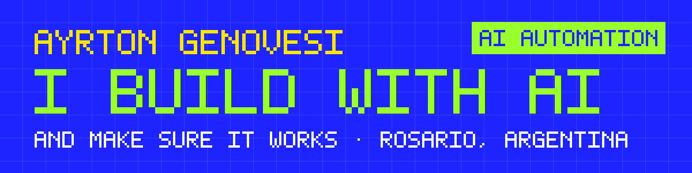

I build automations and software with AI, and I make sure they work for the people who use them: installed, tested with real users, supported and documented.

> **En español:** soy Ayrton, de Rosario. Construyo automatizaciones y software con IA y me ocupo de que funcionen para quien los usa. Técnico Universitario en Programación (UTN). Antes de programar fui encargado de producción en una cervecería y atendí público, y eso me enseñó a entender el problema antes de elegir la herramienta.

## Work

Numbered in the order I built them.

| # | Project | What it is | Status |
|---|---|---|---|
| 01 | [Maintenance System](https://github.com/ayrtongenovesi/maintenance-management-system) | Work orders for building maintenance, from request to PDF report. Angular + Express + MySQL. | UTN final project, 2026 |
| 02 | [Membership Bot](https://github.com/ayrtongenovesi/telegram-membership-bot) | A paid Telegram channel that runs itself: invites, AI FAQ, trials, removals. n8n + Gemini. | Delivered to a client, 2026 |
| 03 | ISITRANS | A Windows app that connects to driving simulators and writes a report per student for the instructor. | Shipped and in use, 2026 · case study coming |
| 04 | [Inbound Triage](https://github.com/ayrtongenovesi/inbound-triage) | Every incoming message classified with AI, stored and routed to the right person. n8n + Gemini + MySQL. | Building in public |

## How I work

1. **Spec first.** I write down what it has to do and how we'll know it works.
2. **AI builds.** Claude Code, Codex and n8n do most of the typing.
3. **I verify.** Tests, real messages, real users. Nothing is done until it works for the person who'll use it.
4. **I stay.** Install, support, document.

## Stack

n8n · Node.js · JavaScript · REST APIs · SQL (MySQL) · LLM APIs (Gemini, OpenAI) · Angular · Git · Postman

## Contact

Rosario, Argentina · Spanish and English · [LinkedIn](https://www.linkedin.com/in/ayrton-genovesi-148b8b248/)

The banners in my repos come from a small script: <a href="tools/banner.py"><code>tools/banner.py</code></a>.
